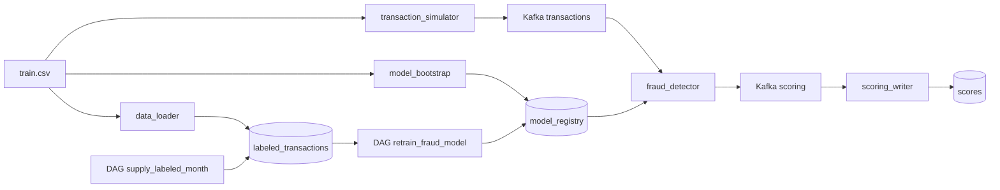

# Антифрод: поток транзакций, скоринг и переобучение в Airflow

Домашнее задание 3 по курсу «Создание ML-систем». Сервис скоринга читает транзакции из Kafka и отдаёт `score`, `fraud_flag` и `model_version`. Поверх него Airflow по расписанию:

* дописывает в размеченную витрину новый месяц (`supply_labeled_month`);
* переобучает CatBoost на скользящем окне, сравнивает кандидата с прод-моделью и публикует его, только если он не хуже (`retrain_fraud_model`).

Сервис скоринга подхватывает новую модель из общего каталога без перезапуска контейнера.

За основу взят код семинара 7. Изменено:

| Что | Семинар | Здесь |
|---|---|---|
| Препроцессинг | `add_features` семинара | собственный модуль `fraud_detector/src/preprocessing.py` (см. ниже) |
| Стартовая модель | бинарник в образе, обученный на старых признаках | сервис `model_bootstrap` учит её при первом старте на собственных признаках |
| Окно обучения | 3 месяца (2 train + 1 test) | **4 месяца (3 train + 1 test)** |
| Батч поставки | 100 000 строк | **50 000 строк** |
| Глубина истории витрины | 3 года | **2 года** |
| Early stopping | по test-месяцу | по последним 15 % train (test не «подсматривается») |
| Quality gate | нет | кандидат публикуется, только если PR-AUC не ниже прода |
| Сдвиг указателя месяца | внутри `publish_model` | отдельная задача `commit_training_window` с идемпотентным `UPDATE` |

Параметры задаются в `.env` (`WINDOW_MONTHS`, `SUPPLY_BATCH_SIZE`, `HISTORY_YEARS`, `QUALITY_TOLERANCE`).

---

## Архитектура



| Сервис | Описание |
|---|---|
| zookeeper, kafka, kafka-setup | Брокер и создание топиков `transactions`, `scoring` |
| kafka-ui | Просмотр топиков, http://localhost:8080 |
| postgres | Витрина `labeled_transactions`, состояние окна `training_state`, результаты `scores` |
| data_loader | Один раз грузит CSV в витрину и сохраняет стартовое окно январь–апрель 2019 в `current.parquet` |
| model_bootstrap | Один раз учит стартовую модель (train янв–мар 2019, test апр 2019) и публикует версию `initial` |
| fraud_detector | Препроцессинг + CatBoost. Перед каждым сообщением читает `/models/latest.txt` и при смене версии загружает `my_catboost_<версия>.cbm` |
| transaction_simulator | Каждые 0.1 с шлёт в `transactions` случайную строку CSV с текущим временем |
| scoring_writer | Пишет `score`, `fraud_flag`, `model_version` из топика `scoring` в таблицу `scores` |
| airflow | Airflow 2.10 standalone, http://localhost:8081, два DAG по расписанию `*/5 * * * *` |

Общий том `model_registry` смонтирован в Airflow как `/opt/airflow/models`, в `fraud_detector` и `model_bootstrap` — как `/models`. Все сервисы в одной сети `ml-scorer`. Airflow видит витрину (Postgres), том `training_data` и код признаков `fraud_detector/src` (смонтирован как `/opt/airflow/fraud_src`), поэтому обучение и скоринг используют один и тот же препроцессинг.

---

## Структура проекта

```
.
├── dags/                         # только сборка графов
│   ├── retrain_fraud_model.py
│   └── supply_labeled_month.py
├── pipeline/
│   ├── settings.py               # пути и параметры (окно, батч, история, gate)
│   ├── features.py               # импорт общих модулей из fraud_detector/src
│   ├── db.py                     # витрина и training_state
│   ├── retrain/                  # функции задач переобучения
│   └── supply/                   # функции задач поставки месяца
├── fraud_detector/
│   ├── src/preprocessing.py      # СОБСТВЕННЫЙ препроцессинг
│   ├── src/training.py           # параметры CatBoost и метрики (общие для DAG и bootstrap)
│   ├── src/scorer.py             # горячая перезагрузка модели по latest.txt
│   └── app/{app.py,bootstrap_model.py}
├── data_loader/  scoring_writer/  transaction_simulator/  airflow/
├── docker-compose.yaml
└── .env.example
```

---

## Запуск

Нужны Docker и Docker Compose v2, свободные порты 8080, 8081, 5432, 9095, 2181.

```bash
git clone <URL этого репозитория>
cd fraud-airflow-retrain
cp .env.example .env
```

В `.env` укажите **абсолютный** путь к размеченному `train.csv` (датасет [teta-ml-1-2025](https://www.kaggle.com/competitions/teta-ml-1-2025/data)):

```
TRAIN_DATA_CSV=/Users/you/Desktop/fraud-airflow-retrain/train.csv
```

Поднимите всё:

```bash
docker compose up -d --build
docker compose ps
```

Первый старт занимает несколько минут: сборка образов, загрузка ~786 тыс. строк в витрину (`data_loader`) и обучение стартовой модели (`model_bootstrap`, ~1 мин). `data_loader` и `model_bootstrap` должны завершиться со статусом `Exited (0)`, остальные сервисы — `Up`.

```bash
docker compose logs model_bootstrap | tail -5   # «Стартовая модель опубликована»
docker compose logs -f fraud_detector           # «Prediction complete ... model_version=initial»
```

| Сервис | Адрес |
|---|---|
| Airflow UI | http://localhost:8081, логин `admin`, пароль `admin` |
| Kafka UI | http://localhost:8080 |
| PostgreSQL | `localhost:5432`, база `fraud_db`, `fraud_user` / `fraud_pass` |

Остановка: `docker compose down`. Полная очистка (витрина, модели, состояние Airflow): `docker compose down -v`.

---

## Как запустить DAG и проверить результат

### 1. DAG в UI

Откройте http://localhost:8081. Оба DAG включены сразу (`DAGS_ARE_PAUSED_AT_CREATION=false`) и идут каждые 5 минут, `catchup=False`. Ручной запуск — кнопка ▶ **Trigger DAG** справа от `retrain_fraud_model`. Во вкладке **Graph** видна цепочка:

```
extract_month_batch → slide_training_window → time_train_test_split → preprocess_dataset
  → fit_catboost → evaluate_vs_prod → publish_model → commit_training_window
```

Либо из терминала:

```bash
docker compose exec airflow airflow dags trigger retrain_fraud_model
docker compose exec airflow airflow dags list-runs -d retrain_fraud_model
```

### 2. В общем каталоге появилась новая модель

```bash
docker compose exec fraud_detector ls -la /models
docker compose exec fraud_detector cat /models/latest.txt
docker compose exec fraud_detector sh -c 'cat /models/my_catboost_$(cat /models/latest.txt).metrics.json'
```

После успешного прогона появляется `my_catboost_<YYYYMMDDTHHMMSS>.cbm`, его `.metrics.json` (метрики кандидата и прода, решение gate) и `latest.txt` указывает на новую версию. Если gate отклонил кандидата, появляется `rejected_<версия>.metrics.json`, а `latest.txt` не меняется.

### 3. Новые транзакции скорятся опубликованной версией

```bash
docker compose exec postgres psql -U fraud_user -d fraud_db -c "
SELECT model_version, count(*), min(created_at) AS first_seen, max(created_at) AS last_seen
FROM scores GROUP BY model_version ORDER BY first_seen;"
```

Версия из `latest.txt` должна появиться в `scores` через несколько секунд после публикации, без перезапуска `fraud_detector` (в его логе: `Загружена модель версии <версия>`). То же поле `model_version` есть в каждом сообщении топика `scoring` в Kafka UI.

### 4. Окно обучения сдвинулось

```bash
docker compose exec postgres psql -U fraud_user -d fraud_db -c "SELECT * FROM training_state;"
```

После каждого успешного прогона `window_start`, `window_end`, `next_batch_month` сдвигаются на месяц.

### 5. Поставка месяца

Trigger `supply_labeled_month`, затем:

```bash
docker compose exec postgres psql -U fraud_user -d fraud_db -c "
SELECT date_trunc('month', transaction_time)::date AS month, count(*)
FROM labeled_transactions GROUP BY 1 ORDER BY 1 DESC LIMIT 5;"
```

Сверху появится новый месяц на 50 000 строк.

---

## DAG `supply_labeled_month`

1. `sample_next_month` — случайные `SUPPLY_BATCH_SIZE` = **50 000** строк витрины, `transaction_time` переносится в месяц после `max(transaction_time)` (день обрезается до конца месяца, часы и минуты сохраняются).
2. `append_labeled_batch` — дозапись батча через `COPY` одной транзакцией.
3. `prune_old_months` — удаление наблюдений старше `HISTORY_YEARS` = **2 лет** от самого нового месяца.

CSV покрывает январь 2019 – март 2020, поэтому первый поставленный месяц — апрель 2020.

## DAG `retrain_fraud_model`

* **Скользящее окно** из `WINDOW_MONTHS` = **4** месяцев. Стартовое окно январь–апрель 2019, первый батч DAG — май 2019. Каждый прогон добавляет следующий месяц и выбрасывает самый старый; размер окна фиксирован.
* **Split по времени**: 3 более ранних месяца — train, самый свежий — test. Случайного split нет.
* **Препроцессинг** — собственный (ниже).
* **Обучение**: CatBoost, `eval_metric=PRAUC`, `auto_class_weights=SqrtBalanced`, early stopping по последним 15 % train по времени.
* **Quality gate** — ниже.
* **Указатель месяца** двигает только `commit_training_window`, последняя задача графа.

Retrain и supply идут по разным указателям: retrain читает исторические месяцы с мая 2019, supply дописывает месяцы после марта 2020. Разрыв между ними (~11 месяцев) меньше глубины истории (2 года), поэтому очистка не удаляет ещё не обработанные retrain-ом месяцы. Если месяца в витрине нет, `extract_month_batch` помечается как skipped, и остальные задачи тоже.

### Почему повторный запуск ничего не ломает

| Задача | Пишет | Почему повтор безопасен |
|---|---|---|
| extract_month_batch | `batches/batch_YYYYMM.parquet` | указатель не меняет, повтор берёт тот же месяц |
| slide_training_window | `pending_window.parquet` | `current.parquet` не трогает; если месяц батча уже лежит в current, он заменяется, а не дублируется |
| time_train_test_split, preprocess_dataset | файлы в `splits/` | перезаписываются, состояние не меняется |
| fit_catboost | `.staging_<v>.cbm` | черновик не виден сервису скоринга |
| evaluate_vs_prod | ничего | только читает |
| publish_model | `.cbm`, `.metrics.json`, `latest.txt` | атомарные `os.replace`; при повторе берётся уже переименованный файл |
| commit_training_window | `current.parquet`, `training_state` | `UPDATE ... WHERE next_batch_month = <месяц батча>` срабатывает один раз |

Если любая задача до `commit_training_window` падает, указатель месяца и окно остаются прежними, и следующий запуск обрабатывает тот же месяц. Месяц не пропускается, окно не сдвигается дважды.

---

## Собственный препроцессинг

`fraud_detector/src/preprocessing.py` используется и в онлайн-скоринге, и в DAG, и при обучении стартовой модели.

| Группа | Признаки |
|---|---|
| Очистка | `amount` в число, обрезка снизу нулём; пропуски в числах → 0, в категориях → `unknown` |
| Сумма | `amount`, `amount_log = log1p(amount)`, `amount_is_round` (кратна 10) |
| Время | `hour`, `hour_sin`/`hour_cos` (циклическое кодирование), `day_of_week`, `is_night` (22:00–06:00), `is_weekend` |
| География | `lat`, `lon`, `dist_km` — гаверсинус клиент → мерчант, `dist_log`, `city_pop_log` |
| Клиент | `is_male` (пол в 0/1) |
| Категории (CatBoost cat_features) | `merch`, `cat_id`, `us_state`, `jobs`, `cat_night` = `cat_id` × день/ночь |
| Удаляются | `name_1`, `name_2`, `street`, `post_code`, `one_city`, сырые координаты мерчанта, сам `transaction_time` |

---

## Quality gate: проверка улучшения модели

Задача `evaluate_vs_prod` между обучением и публикацией.

1. **Одни и те же данные.** Кандидат и текущая прод-модель (`latest.txt`) скорят один и тот же test-месяц, самый свежий месяц окна. Ни одна из них его не видела: прод учился на окне, которое заканчивалось на месяц раньше, а у кандидата early stopping идёт по хвосту train, а не по test.
2. **Метрика — PR-AUC** (average precision). Доля фрода около 0.5 %, ROC-AUC на таком дисбалансе у всех моделей около 0.99 и почти не различает их. PR-AUC показывает качество в зоне, где работает антифрод: на верхушке скоров. Порог-зависимые F1 и recall и ROC-AUC тоже считаются и пишутся в отчёт.
3. **Правило:** `publish`, если `PR-AUC(кандидат) >= PR-AUC(прод) − QUALITY_TOLERANCE` (по умолчанию 0, то есть «не хуже»). Иначе `reject`: модель не копируется в каталог, `latest.txt` не меняется, пишется `rejected_<версия>.metrics.json` с обеими метриками.
4. Если прод-модели нет, она несовместима по признакам или в test-месяце один класс (PR-AUC не определён), кандидат публикуется.
5. Отклонённый кандидат **всё равно сдвигает окно**: месяц данных обработан, иначе DAG бесконечно переучивался бы на одном окне. Прод остаётся на старой версии, пока какой-нибудь следующий кандидат его не обгонит.

Пример на реальных данных (локальный прогон тех же функций):

| Батч | Train | Test | PR-AUC кандидата | PR-AUC прода | Решение |
|---|---|---|---|---|---|
| 2019-05 | 02–04.2019 | 05.2019 | 0.633 | 0.582 | publish |
| 2019-06 | 03–05.2019 | 06.2019 | 0.556 | 0.502 | publish |
| 2019-07 | 04–06.2019 | 07.2019 | 0.633 | 0.637 | **reject** |

Принудительно проверить ветку отказа: поставить в `.env` `QUALITY_TOLERANCE=-1` (кандидат должен обогнать прод на 1.0 PR-AUC, что невозможно), `docker compose up -d airflow`, запустить DAG. В логе `evaluate_vs_prod` будет `reject`, в каталоге `rejected_*.metrics.json`, версия в `scores` не изменится.

Отчёты решений:

```bash
docker compose exec fraud_detector sh -c 'ls /models/*.metrics.json'
```

---

## Таблица `scores`

| Поле | Описание |
|---|---|
| transaction_id | ID транзакции |
| score | вероятность фрода |
| fraud_flag | 1, если score > 0.5 |
| model_version | версия модели (`initial` или `YYYYMMDDTHHMMSS`), посчитавшая скор |
| created_at | время записи |

---

## Типичные проблемы

* `model_bootstrap`/`data_loader` падают с `FileNotFoundError` — неверный `TRAIN_DATA_CSV` в `.env`, нужен абсолютный путь.
* Порт занят — освободите 8080/8081/5432/9095 или поменяйте проброс в `docker-compose.yaml`.
* DAG не видно сразу — Airflow сканирует папку раз в 30 с, подождите минуту после старта.
